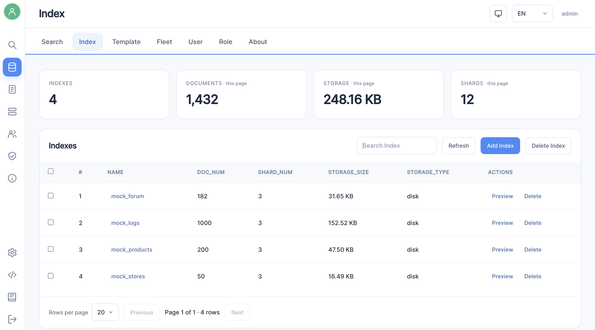

<p align="center">
  
</p>

[](https://github.com/vcaesar/zedsearch/actions/workflows/ci.yml)
[](https://github.com/vcaesar/zedsearch/actions/workflows/nightly.yml)
[](https://github.com/vcaesar/zedsearch/actions/workflows/release.yml)
[](https://pkg.go.dev/github.com/vcaesar/zedsearch)
[](../go.mod)
[](https://golangci-lint.run/)
[](https://github.com/vcaesar/zedsearch/releases/latest)
[](../docs/web/index.md) [](https://app.codecov.io/gh/vcaesar/zedsearch)
<a href="https://discord.gg/535uZPakJw"></a>

[English](../README.md) | [简体中文](README.zh.md) | [繁體中文](README.zht.md) | [日本語](README.ja.md) | [한국어](README.ko.md) | [Français](README.fr.md) | [Deutsch](README.de.md) | [Español](README.es.md) | [Русский](README.ru.md) | Português

# ZedSearch

ZedSearch é um mecanismo de busca que faz indexação de texto completo e vetorial, e uma plataforma cloud-native de observabilidade para logs, métricas, traces, análises, monitoramento e IA.
É uma alternativa leve ao Elasticsearch, OpenSearch, Datadog e Splunk e roda usando uma fração dos recursos.
Ele usa o [vcaesar/riot](https://github.com/vcaesar/riot) como biblioteca de indexação subjacente.

É muito simples e fácil de operar, ao contrário do Elasticsearch, que exige entender e ajustar algumas dezenas de parâmetros. Você pode colocar o ZedSearch em funcionamento em 1 minuto.

É um substituto direto do Elasticsearch se você apenas ingere e pesquisa dados pelas APIs. O Kibana não é suportado, o ZedSearch oferece sua própria interface.

<!-- Assista ao vídeo abaixo para uma demonstração rápida do ZedSearch. -->
<!-- [](https://www.youtube.com/watch?v=aZXtuVjt1ow) -->

## Homebrew

macOS e Linux, via [vcaesar/homebrew-tap](https://github.com/vcaesar/homebrew-tap):

```sh
brew install vcaesar/tap/zedsearch
```

## Docker

As imagens estão no [Docker Hub](https://hub.docker.com/r/riotgo/zedsearch) como `riotgo/zedsearch` (linux/amd64, linux/arm64, linux/arm/v7):

Antes de executar o comando, defina `ZED_FIRST_ADMIN_PASSWORD` no ambiente com a senha escolhida:

```sh
docker run -d --name zedsearch \
    -p 4080:4080 \
    -v zedsearch-data:/data -e ZED_DATA_PATH=/data \
    -e ZED_FIRST_ADMIN_USER="admin" \
    -e ZED_FIRST_ADMIN_PASSWORD="your_password_zed#123" \
    riotgo/zedsearch:latest
```

O volume nomeado `zedsearch-data` é gravável pelo usuário do contêiner (uid 10001); para usar um diretório do host, execute `mkdir -p ./data && sudo chown 10001:10001 ./data` e monte `-v "$PWD/data:/data"`.

## Cluster

Os nós compartilham um etcd e dividem entre si a propriedade dos índices, com réplicas e failover; qualquer nó atende qualquer requisição. Cada nó precisa de um `ZED_CLUSTER_NODE_ID` único, de um `ZED_CLUSTER_ADVERTISE_ADDR` acessível pelos outros nós e do mesmo `ZED_CLUSTER_SECRET`. Veja [pkg/cluster](../pkg/cluster/README.md) para o modelo, as configurações e os limites.

### Docker

```sh
# Use your own admin password and a fresh cluster secret for every deployment.
ZED_PASSWORD='your_password_zed#123'
ZED_SECRET="$(openssl rand -hex 32)"

docker network create zed
docker run -d --name zed-etcd --network zed --restart unless-stopped \
    -v zed-etcd-data:/etcd-data quay.io/coreos/etcd:v3.7.3 etcd \
    --listen-client-urls http://0.0.0.0:2379 --advertise-client-urls http://zed-etcd:2379 \
    --data-dir /etcd-data

# Node to node traffic, with the secret, is plain HTTP on the private network "zed",
# so ports are published on localhost only. Across hosts use an encrypted network, or
# advertise https:// addresses and serve them: ZED_SERVER_TLS_CERTIFICATE_FILE and
# ZED_SERVER_TLS_KEY_FILE on every node (or a TLS proxy in front of it), with a
# certificate the other nodes trust (system roots, or a private CA added with
# SSL_CERT_FILE / SSL_CERT_DIR as k8s/cluster.yaml does).
# --restart retries a node that started before etcd.
for i in 1 2 3; do
  docker run -d --name zed$i --network zed -p 127.0.0.1:408$i:4080 --restart unless-stopped \
    -v zed$i-data:/data -e ZED_DATA_PATH=/data \
    -e ZED_FIRST_ADMIN_USER="admin" -e ZED_FIRST_ADMIN_PASSWORD="$ZED_PASSWORD" \
    -e ZED_CLUSTER_ENABLE=true -e ZED_CLUSTER_NAME=prod -e ZED_CLUSTER_NODE_ID=node-$i \
    -e ZED_CLUSTER_ADVERTISE_ADDR=http://zed$i:4080 -e ZED_CLUSTER_SECRET="$ZED_SECRET" \
    -e ZED_ETCD_ENDPOINTS=http://zed-etcd:2379 \
    riotgo/zedsearch:latest
done

curl --retry 10 --retry-connrefused -u admin:"$ZED_PASSWORD" http://localhost:4081/api/cluster/nodes

# Back up the shared metadata in zed-etcd-data; the copy runs only after a successful save.
docker exec zed-etcd etcdctl snapshot save /etcd-data/snapshot.db &&
  docker cp zed-etcd:/etcd-data/snapshot.db ./etcd-snapshot.db
# Restore with every node stopped: `etcdutl snapshot restore` into a new volume, then
# empty the in-sync sets before the nodes start, since a replica listed in an old
# snapshot may have missed later writes. Steps: pkg/cluster/README.md, "Backup and restore".
```

### Kubernetes

[k8s/cluster.yaml](../k8s/cluster.yaml) executa um StatefulSet `zedsearch-cluster` de três nós atrás do Service `zedsearch`, com um etcd de nó único (use três membros em produção):

```sh
# needs cert-manager for the node TLS certificates; nodes serve HTTPS
kubectl create namespace zedsearch
kubectl -n zedsearch create secret generic zedsearch-admin \
    --from-literal=ZED_FIRST_ADMIN_USER=admin --from-literal=ZED_FIRST_ADMIN_PASSWORD='your_password_zed#123'
kubectl -n zedsearch create secret generic zedsearch-cluster \
    --from-literal=ZED_CLUSTER_SECRET="$(openssl rand -hex 32)"
kubectl apply -f k8s/cluster.yaml
kubectl -n zedsearch wait --for=jsonpath='{.status.readyReplicas}'=3 statefulset/zedsearch-cluster --timeout=10m
kubectl -n zedsearch port-forward svc/zedsearch 4080:4080 &
kubectl -n zedsearch get secret zedsearch-tls -o jsonpath='{.data.ca\.crt}' | base64 -d > zedsearch-ca.crt

curl --retry 10 --retry-connrefused --cacert zedsearch-ca.crt -u admin:'your_password_zed#123' https://localhost:4080/api/cluster/nodes
```

# Por que ZedSearch

O Elasticsearch e mecanismos semelhantes são produtos muito bons, mas são complexos, exigem muita memória e outros recursos e carregam mais de uma década de histórico de design.
Criei o ZedSearch para que a busca de texto completo e vetorial, a observabilidade e a análise de dados fiquem mais fáceis, mais rápidas e gratuitas, sem muito trabalho.

# Recursos

go + gin (ou fiber v3 com `-tags fiber`) + react

1. Consultas rápidas e arquivos de índice menores
2. Oferece capacidade de indexação de texto completo e vetorial
3. Binário único para instalação e execução. Binários disponíveis nas releases para várias plataformas.
4. Interface web para consultar dados escrita em React (embutida no binário)
5. Compatibilidade com as APIs do Elasticsearch para ingestão de dados (API de registro único e bulk)
6. Autenticação pronta para uso
7. Sem esquema - não é necessário definir um esquema antecipadamente e documentos diferentes no mesmo índice podem ter campos diferentes.
8. Armazenamento de índices em disco, S3, MinIO e outros
9. Agregações e ampla compatibilidade com a API do Elasticsearch, com suporte a recursos completos
10. Análise em vários idiomas, incluindo CJK
11. [Índices de logs](../pkg/logs/README.md) opcionais com normalização do horário do evento e padrões para busca em logs, com ingestão de JSON, Splunk HEC, Loki e OTLP/HTTP JSON (compatível com OpenObserve) e eventos do Logstash
12. Busca vetorial kNN e consultas geográficas (`geo_distance`, `geo_bounding_box`, `geo_polygon`, `geo_shape`)
13. Consultas SQL pela API SQL do Elasticsearch (`/es/_sql`, `/api/_sql`, `/es/_sql/translate`): `SELECT … WHERE` (`LIKE`, `IN`, `BETWEEN`, `IS NULL`, `MATCH()`, `QUERY()`), `COUNT`/`SUM`/`AVG`/`MIN`/`MAX`, `GROUP BY` (`HISTOGRAM`, `DATE_HISTOGRAM`), `HAVING`, `ORDER BY`, `LIMIT`, com saída JSON, txt, csv ou tsv; e [esquemas MySQL `CREATE TABLE` como mappings](../docs/sql-mappings.md)
14. [Cluster](../pkg/cluster/README.md) de alta disponibilidade: propriedade de partições coordenada pelo etcd, transferência com fencing, réplicas e busca scatter-gather
15. Rastreamento OpenTelemetry via OTLP/HTTP (`zed_tracing_enable`); cada requisição recebe um `X-Trace-Id` que a acompanha entre os nós
16. Fleet e `zedagent` (`agent/`): registro de agentes, gestão de políticas, envio de arquivos de log e métricas do sistema, ou agente autônomo
17. [Crawler web](../pkg/crawler/README.md) que respeita robots.txt (`cmd/zedcrawl`), com PageRank e indexação bulk no ZedSearch
18. Camadas de dados: hot (disco local), warm (armazenamento de objetos) e cold (armazenamento de objetos somente leitura compartilhado por todos os nós), alternadas via `/api/index/{index}/_tier` ou pelo ciclo de vida do índice (`warm_after`, `cold_after`, `delete_after`) e políticas ILM (`/es/_ilm/policy`)
19. Conjuntos de sinônimos (`/es/_synonyms`) com recarga dos analisadores de busca, e regras de consulta (`/es/_query_rules`) que fixam ou excluem documentos
20. Rescoring de [Learning to rank](../docs/learning-to-rank.md) com modelos lineares, de árvore e XGBoost (`/es/_ml/trained_models`), avaliados em Go puro
21. Mais APIs do Elasticsearch: `_msearch`, `_count`, `_delete_by_query`, `_reindex`, `_field_caps`, aliases, modelos de índice, `_cat/indices`, `_cat/health` e `_cluster/health`

# Benchmarks

Sete consultas de aplicação de busca sobre 50.000 documentos (top 10 mais o total exato), em um MacBook Pro M1, com cada servidor no Docker: uma consulta term filtrada, um OR sobre dois campos, uma ordenação por preço sobre todos os documentos, a página 101, uma agregação terms e uma histogram, e destaque. Menor é melhor, exceto em QPS; "—" significa que o mecanismo não consegue expressar a consulta (o Meilisearch não tem histograma numérico e o OpenObserve não destaca).

| Consulta                   |     ZedSearch | ZincSearch 0.4.10 | Elasticsearch 9.5 | OpenSearch 3.9 | Meilisearch 1.56 | OpenObserve 1.1 |
| -------------------------- | ------------: | ----------------: | ----------------: | -------------: | ---------------: | --------------: |
| `filtered` (1 cliente)     |   **0.89 ms** |           3.43 ms |           1.38 ms |        1.44 ms |          1.87 ms |         9.44 ms |
| `filtered` (8 clientes)    | **3,216 QPS** |           471 QPS |         2,742 QPS |      3,066 QPS |        1,924 QPS |         321 QPS |
| `sort_price` (50 mil docs) |   **0.74 ms** |           76.0 ms |           2.52 ms |        1.58 ms |          1.09 ms |         4.40 ms |
| `multi_field` title + body |   **0.63 ms** |           2.04 ms |           1.44 ms |        1.51 ms |          1.19 ms |         21.0 ms |
| `deep_page` from 1000      |   **1.24 ms** |           3.40 ms |           1.42 ms |        1.47 ms |          12.7 ms |         18.1 ms |
| `agg_terms` `category`     |   **1.48 ms** |           5.55 ms |           1.66 ms |        2.12 ms |          1.63 ms |         18.6 ms |
| `agg_histogram` `price`    |   **1.00 ms** |           20.1 ms |           1.67 ms |        1.72 ms |                — |         18.7 ms |
| `highlight` `body`         |   **0.81 ms** |           2.27 ms |           1.96 ms |        1.97 ms |          1.92 ms |               — |

### Consultas simples (v2)

As consultas v2 das mesmas sessões, um único tipo de consulta cada. O Meilisearch não consegue expressar OR nem frases exatas.

| Consulta                   |     ZedSearch | ZincSearch 0.4.10 | Elasticsearch 9.5 | OpenSearch 3.9 | Meilisearch 1.56 | OpenObserve 1.1 |
| -------------------------- | ------------: | ----------------: | ----------------: | -------------: | ---------------: | --------------: |
| `term` rare                |   **0.50 ms** |           1.03 ms |           1.43 ms |        1.16 ms |          1.14 ms |         15.7 ms |
| `term` mid                 |   **0.58 ms** |           1.82 ms |           1.28 ms |        1.27 ms |          1.16 ms |         17.6 ms |
| `term` keyword             |   **0.57 ms** |           0.82 ms |           1.75 ms |        2.32 ms |          1.03 ms |         5.59 ms |
| `bool` should              |   **0.63 ms** |           1.12 ms |           1.61 ms |        1.75 ms |                — |         26.7 ms |
| `bool` must                |   **1.01 ms** |           1.79 ms |           2.36 ms |        3.30 ms |          1.28 ms |         24.1 ms |
| `range`                    |   **0.64 ms** |           2.56 ms |           1.32 ms |        1.28 ms |          1.32 ms |         5.31 ms |
| `match_all`                |   **0.66 ms** |           4.12 ms |           1.48 ms |        1.38 ms |          1.03 ms |         4.68 ms |
| `prefix` `w1*`             |   **0.71 ms** |          214.5 ms |           1.87 ms |        2.66 ms |          1.32 ms |         11.9 ms |
| `match_phrase`             |   **10.3 ms** |           55.6 ms |           12.7 ms |        12.6 ms |                — |         16.3 ms |
| `bool` should (8 clientes) | **5,179 QPS** |         1,292 QPS |         2,707 QPS |      2,616 QPS |                — |         131 QPS |

### Consumo de recursos

Imagem Docker (sem compressão), índice de texto dos mesmos 50.000 documentos (cerca de 25 MB para ZedSearch, Elasticsearch e OpenSearch após `_flush`), e memória / CPU durante toda a execução (100% = 1 vCPU), os dados são a mediana de três execuções.

| Recurso                   |   ZedSearch | ZincSearch 0.4.10 | Elasticsearch 9.5 | OpenSearch 3.9 | Meilisearch 1.56 |        OpenObserve 1.1 |
| ------------------------- | ----------: | ----------------: | ----------------: | -------------: | ---------------: | ---------------------: |
| Imagem Docker             | **56.4 MB** |           72.4 MB |          1,195 MB |       1,311 MB |           370 MB |                 434 MB |
| Índice de texto, 50k docs |     25.9 MB |          133.3 MB |           25.8 MB |        25.7 MB |           454 MB | 14.2 MB (não indexado) |
| Memória ociosa            |  **14 MiB** |            64 MiB |         2,674 MiB |      2,699 MiB |          179 MiB |                387 MiB |
| Memória de pico           | **388 MiB** |           858 MiB |         3,185 MiB |      3,191 MiB |        1,014 MiB |                919 MiB |
| CPU média                 |    **134%** |              366% |              157% |           156% |             230% |                   140% |
| CPU de pico               |        553% |              710% |              620% |           529% |             545% |               **519%** |

### Busca vetorial

20.000 vetores cosseno de 128 dimensões, k=10, HNSW (M=16, ef_construction 100, 100 candidatos), via HTTP na mesma máquina e no mesmo corpus. Maior é melhor em recall, QPS e envio; o índice vetorial é o crescimento dos dados após o envio, antes do `_flush`.

| Métrica                      |        ZedSearch | Elasticsearch 9.5 | OpenSearch 3.9 | Meilisearch 1.56 | Qdrant 1.20 | Milvus 3.0 | Weaviate 1.40 |
| ---------------------------- | ---------------: | ----------------: | -------------: | ---------------: | ----------: | ---------: | ------------: |
| Recall@10                    |            0.939 |         **0.956** |          0.823 |            0.485 |       0.891 |      0.685 |         0.595 |
| Latência, 1 cliente          |      **1.47 ms** |           2.56 ms |        2.09 ms |          4.71 ms |     1.84 ms |    2.70 ms |       2.28 ms |
| QPS, 8 clientes              |    **1,923 QPS** |           983 QPS |      1,385 QPS |        1,025 QPS |   1,653 QPS |  1,827 QPS |     1,706 QPS |
| Envio + indexação            | **10,070 vec/s** |       3,004 vec/s |    1,770 vec/s |        377 vec/s | 4,609 vec/s |  999 vec/s |   3,103 vec/s |
| Índice vetorial, 20k × 128-d |          28.3 MB |           63.9 MB |        75.6 MB |      **25.8 MB** |     41.4 MB |    34.3 MB |       75.6 MB |

### Busca vetorial, cluster de 3 nós

Medianas de três execuções: três nós com 1 réplica em uma única VM Docker de 8 vCPU, ZedSearch com etcd e replicação `document`. Os nós compartilham as CPUs, então isso mede o custo da replicação, não a escala horizontal.

| Métrica                                     |     ZedSearch ×3 |     OpenSearch ×3 |
| ------------------------------------------- | ---------------: | ----------------: |
| Recall@10                                   |        **0.960** |             0.905 |
| Latência, 1 cliente                         |      **1.81 ms** |           3.59 ms |
| QPS, 8 clientes                             |    **1,611 QPS** |           970 QPS |
| Envio + indexação                           |  **4,157 vec/s** |       1,451 vec/s |
| Índice vetorial após `_flush`, todos os nós |      **56.5 MB** |           70.4 MB |
| Memória ociosa / de pico, todos os nós      | **78 / 902 MiB** | 4,517 / 5,360 MiB |

# Documentação

A documentação está disponível em [docs/web](../docs/web/index.md) e a documentação da API em [zedsearch-docs](https://github.com/zedsearch/zedsearch-docs)

# Capturas de tela

## Tela de busca


## Tela de índices



# Primeiros passos

## Início rápido

Veja o [início rápido](../docs/web/quickstart.md)

# Versões

O ZedSearch tem centenas de instalações em produção.

Os binários para todas as plataformas estão na [página de releases](https://github.com/vcaesar/zedsearch/releases/latest). Os arquivos padrão não são compactados com UPX; para um download menor, todas as builds para Linux e a build para Windows amd64 também são publicadas como `*_upx.tar.gz` compactado com [UPX](https://upx.github.io/) (inicialização um pouco mais lenta, e alguns antivírus podem sinalizar arquivos `.exe` compactados).

## Build

Defina `ZED_FIRST_ADMIN_USER` / `ZED_FIRST_ADMIN_PASSWORD` ou configure `conf/zed.toml` (veja abaixo) e execute a partir da raiz do repositório:

```sh
go run cmd/zedsearch/main.go      # API-only, :4080
go run cmd/zedsearch/main.go web  # with the web UI (Node.js 24+ and npm)
```

`web` gera `test/zedsearch-web`, um binário independente com a interface embutida.

### Configuração

As configurações são aplicadas nesta ordem: padrões embutidos ([`pkg/config/default.toml`](../pkg/config/default.toml)), depois o `conf/zed.toml` opcional no diretório de trabalho e, por fim, variáveis de ambiente não vazias. Cada chave em maiúsculas também é uma variável de ambiente, por exemplo `zed_server_port` → `ZED_SERVER_PORT`.

```toml
# conf/zed.toml
zed_first_admin_user = "admin"
zed_first_admin_password = "change-me"
zed_server_port = "4080"
zed_data_path = "./data"
zed_log_level = "info"

[Shard]
zed_shard_num = 3
```

- Inclua apenas as chaves que você alterar; chaves agrupadas mantêm o cabeçalho de tabela do `default.toml` (`[Shard]`, `[S3]`, `[Etcd]`, ...).
- Chaves desconhecidas fazem a inicialização falhar. Durações são em nanossegundos e tamanhos em bytes.
- As credenciais do primeiro administrador só criam o usuário admin na primeira inicialização; altere a senha após o login e nunca faça commit de credenciais reais.

# Comunidade

- Como desenvolver e contribuir com o ZedSearch

  Veja o [guia de contribuição](../CONTRIBUTING.md). Veja também o [roadmap](../docs/web/roadmap.md)

# Exemplos

Você pode usar o ZedSearch para indexar e pesquisar quaisquer dados. [examples/](../examples) tem scripts Python que indexam um documento, carregam arquivos do Word e os pesquisam.

Projetos da comunidade que indexam e pesquisam o conjunto de dados de e-mails da Enron com o ZincSearch (o ZedSearch mantém seus endpoints `/api`):

1. https://github.com/jorgeloaiza48/Enron-Email-DataSet
1. https://github.com/jhojanperlaza/email_search_engine
1. https://github.com/carlosarraes/zinmail
1. https://github.com/devjopa/golab-search
1. https://github.com/avaco2312/zincsearch
1. https://github.com/paolorossig/email-indexer
1. https://github.com/ulimonte05/zincsearching
