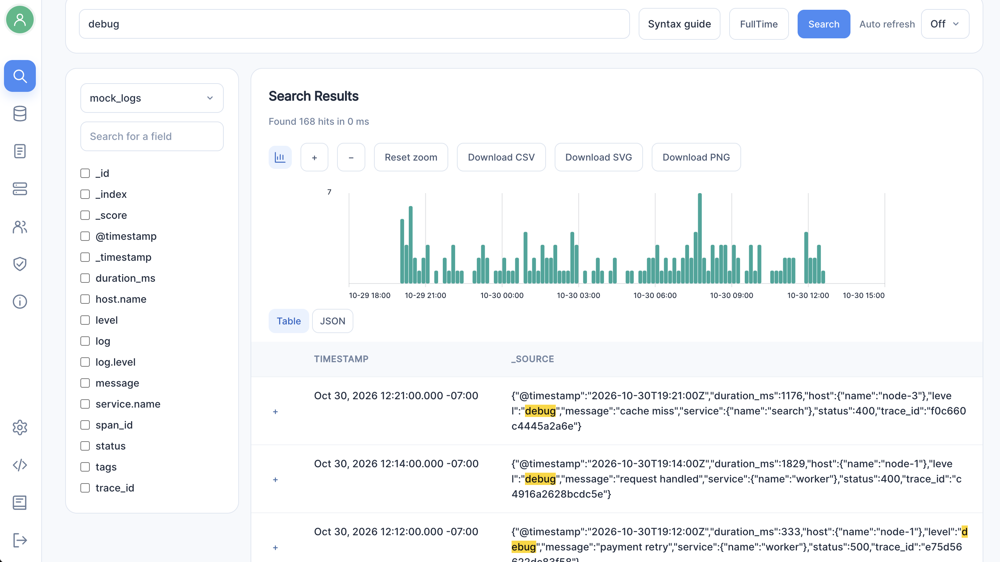

<p align="center">
  
</p>

[](https://github.com/vcaesar/zedsearch/actions/workflows/ci.yml)
[](https://github.com/vcaesar/zedsearch/actions/workflows/nightly.yml)
[](https://github.com/vcaesar/zedsearch/actions/workflows/release.yml)
[](https://pkg.go.dev/github.com/vcaesar/zedsearch)
[](../go.mod)
[](https://golangci-lint.run/)
[](https://github.com/vcaesar/zedsearch/releases/latest)
[](../docs/web/index.md) [](https://app.codecov.io/gh/vcaesar/zedsearch)
<a href="https://discord.gg/535uZPakJw"></a>

[English](../README.md) | [简体中文](README.zh.md) | 繁體中文 | [日本語](README.ja.md) | [한국어](README.ko.md) | [Français](README.fr.md) | [Deutsch](README.de.md) | [Español](README.es.md) | [Русский](README.ru.md) | [Português](README.pt.md)

# ZedSearch

ZedSearch 是一個進行全文索引與向量索引的搜尋引擎，也是一個面向可觀測性的雲原生平台，涵蓋日誌、指標、鏈路追蹤、分析、監控與 AI。
它是 Elasticsearch、OpenSearch、Datadog、Splunk 的輕量級替代方案，只需一小部分資源即可執行。
它使用 [vcaesar/riot](https://github.com/vcaesar/riot) 作為底層索引函式庫。

相較於需要理解與調整數十個參數的 Elasticsearch，它非常簡單且容易維運。你可以在 1 分鐘內啟動並執行 ZedSearch。

如果你只透過 API 寫入與搜尋資料，它可以直接取代 Elasticsearch。ZedSearch 不支援 Kibana，但提供自己的 UI。

<!-- 觀看下方影片，快速了解 ZedSearch 的展示。 -->
<!-- [](https://www.youtube.com/watch?v=aZXtuVjt1ow) -->

## Homebrew

macOS 與 Linux，透過 [vcaesar/homebrew-tap](https://github.com/vcaesar/homebrew-tap) 安裝：

```sh
brew install vcaesar/tap/zedsearch
```

## Docker

映像檔發布於 [Docker Hub](https://hub.docker.com/r/riotgo/zedsearch)，名稱為 `riotgo/zedsearch`（linux/amd64、linux/arm64、linux/arm/v7）：

執行前，請將環境變數 `ZED_FIRST_ADMIN_PASSWORD` 設為所選密碼：

```sh
docker run -d --name zedsearch \
    -p 4080:4080 \
    -v zedsearch-data:/data -e ZED_DATA_PATH=/data \
    -e ZED_FIRST_ADMIN_USER="admin" \
    -e ZED_FIRST_ADMIN_PASSWORD="your_password_zed#123" \
    riotgo/zedsearch:latest
```

具名磁碟區 `zedsearch-data` 可由容器使用者（uid 10001）寫入；若要改用主機目錄，請先執行 `mkdir -p ./data && sudo chown 10001:10001 ./data`，再掛載 `-v "$PWD/data:/data"`。

## 叢集

各節點共用一個 etcd，並在彼此之間分配索引的擁有權，支援副本與容錯移轉；任一節點都可處理任一請求。每個節點需要唯一的 `ZED_CLUSTER_NODE_ID`、其他節點可存取的 `ZED_CLUSTER_ADVERTISE_ADDR`，以及相同的 `ZED_CLUSTER_SECRET`。模型、設定與限制詳見 [pkg/cluster](../pkg/cluster/README.md)。

### Docker

```sh
# Use your own admin password and a fresh cluster secret for every deployment.
ZED_PASSWORD='your_password_zed#123'
ZED_SECRET="$(openssl rand -hex 32)"

docker network create zed
docker run -d --name zed-etcd --network zed --restart unless-stopped \
    -v zed-etcd-data:/etcd-data quay.io/coreos/etcd:v3.7.3 etcd \
    --listen-client-urls http://0.0.0.0:2379 --advertise-client-urls http://zed-etcd:2379 \
    --data-dir /etcd-data

# Node to node traffic, with the secret, is plain HTTP on the private network "zed",
# so ports are published on localhost only. Across hosts use an encrypted network, or
# advertise https:// addresses and serve them: ZED_SERVER_TLS_CERTIFICATE_FILE and
# ZED_SERVER_TLS_KEY_FILE on every node (or a TLS proxy in front of it), with a
# certificate the other nodes trust (system roots, or a private CA added with
# SSL_CERT_FILE / SSL_CERT_DIR as k8s/cluster.yaml does).
# --restart retries a node that started before etcd.
for i in 1 2 3; do
  docker run -d --name zed$i --network zed -p 127.0.0.1:408$i:4080 --restart unless-stopped \
    -v zed$i-data:/data -e ZED_DATA_PATH=/data \
    -e ZED_FIRST_ADMIN_USER="admin" -e ZED_FIRST_ADMIN_PASSWORD="$ZED_PASSWORD" \
    -e ZED_CLUSTER_ENABLE=true -e ZED_CLUSTER_NAME=prod -e ZED_CLUSTER_NODE_ID=node-$i \
    -e ZED_CLUSTER_ADVERTISE_ADDR=http://zed$i:4080 -e ZED_CLUSTER_SECRET="$ZED_SECRET" \
    -e ZED_ETCD_ENDPOINTS=http://zed-etcd:2379 \
    riotgo/zedsearch:latest
done

curl --retry 10 --retry-connrefused -u admin:"$ZED_PASSWORD" http://localhost:4081/api/cluster/nodes

# Back up the shared metadata in zed-etcd-data; the copy runs only after a successful save.
docker exec zed-etcd etcdctl snapshot save /etcd-data/snapshot.db &&
  docker cp zed-etcd:/etcd-data/snapshot.db ./etcd-snapshot.db

# Restore with every node stopped: `etcdutl snapshot restore` into a new volume, then
# empty the in-sync sets before the nodes start, since a replica listed in an old
# snapshot may have missed later writes. Steps: pkg/cluster/README.md, "Backup and restore".
```

### Kubernetes

[k8s/cluster.yaml](../k8s/cluster.yaml) 在 Service `zedsearch` 之後執行一個三節點 StatefulSet `zedsearch-cluster`，並附帶單節點 etcd（正式環境請執行三個成員）：

```sh
# needs cert-manager for the node TLS certificates; nodes serve HTTPS
kubectl create namespace zedsearch
kubectl -n zedsearch create secret generic zedsearch-admin \
    --from-literal=ZED_FIRST_ADMIN_USER=admin --from-literal=ZED_FIRST_ADMIN_PASSWORD='your_password_zed#123'
kubectl -n zedsearch create secret generic zedsearch-cluster \
    --from-literal=ZED_CLUSTER_SECRET="$(openssl rand -hex 32)"
kubectl apply -f k8s/cluster.yaml
kubectl -n zedsearch wait --for=jsonpath='{.status.readyReplicas}'=3 statefulset/zedsearch-cluster --timeout=10m
kubectl -n zedsearch port-forward svc/zedsearch 4080:4080 &
kubectl -n zedsearch get secret zedsearch-tls -o jsonpath='{.data.ca\.crt}' | base64 -d > zedsearch-ca.crt

curl --retry 10 --retry-connrefused --cacert zedsearch-ca.crt -u admin:'your_password_zed#123' https://localhost:4080/api/cluster/nodes
```

# 為什麼選擇 ZedSearch

Elasticsearch 及同類引擎都是非常優秀的產品，但它們複雜，需要大量記憶體與其他資源，並背負著十多年的設計歷史。
我打造 ZedSearch，是為了讓全文與向量搜尋、可觀測性與資料分析無需大量工作就能更輕鬆、更快速且免費地使用。

# 功能

go + gin（或使用 `-tags fiber` 改用 fiber v3）+ react

1. 查詢速度快，索引檔案更小
2. 提供全文索引與向量索引能力
3. 單一執行檔即可安裝與執行。Releases 中提供多種平台的執行檔。
4. 以 React 撰寫的資料查詢 Web UI（內嵌於執行檔中）
5. 相容 Elasticsearch 的資料寫入 API（單筆記錄與批次 API）
6. 開箱即用的身分驗證
7. 無結構描述（Schema less）—— 無需預先定義 schema，同一索引中的不同文件可以擁有不同的欄位。
8. 索引可儲存於磁碟、S3、MinIO 等
9. 聚合以及廣泛的 Elasticsearch API 相容性，支援完整功能
10. 多語言分析，包括中日韓（CJK）
11. 可選擇啟用的[日誌索引](../pkg/logs/README.md)，支援事件時間正規化與日誌搜尋預設設定，可寫入 JSON、Splunk HEC、Loki、OTLP/HTTP JSON（相容 OpenObserve）及 Logstash 事件
12. kNN 向量搜尋與地理查詢（`geo_distance`、`geo_bounding_box`、`geo_polygon`、`geo_shape`）
13. 融合全文與 kNN 命中的混合搜尋：Elasticsearch `rrf` 與 `linear` 檢索器（權重、`minmax`/`l2_norm`）、舊版 `rank.rrf`，以及帶內嵌 `search_pipeline`（`normalization-processor`、`score-ranker-processor` RRF）的 OpenSearch `hybrid` 查詢
14. 透過 Elasticsearch SQL API（`/es/_sql`, `/api/_sql`, `/es/_sql/translate`）執行 SQL 查詢：`SELECT … WHERE` (`LIKE`, `IN`, `BETWEEN`, `IS NULL`, `MATCH()`, `QUERY()`), `COUNT`/`SUM`/`AVG`/`MIN`/`MAX`, `GROUP BY` (`HISTOGRAM`, `DATE_HISTOGRAM`), `HAVING`, `ORDER BY`, `LIMIT`，輸出 JSON、txt、csv 或 tsv；並支援將 MySQL `CREATE TABLE` [schema 用作 mappings](../docs/sql-mappings.md)
15. 高可用[叢集](../pkg/cluster/README.md)：以 etcd 協調的分區擁有權、具 fencing 的移交、副本以及 scatter-gather 搜尋
16. 透過 OTLP/HTTP 匯出 OpenTelemetry 追蹤（`zed_tracing_enable`）；每個請求都有跨節點傳遞的 `X-Trace-Id`
17. 資料分層：hot（本機磁碟）、warm（物件儲存）和 cold（唯讀物件儲存，所有節點共用），可透過 `/api/index/{index}/_tier` 或索引生命週期（`warm_after`、`cold_after`、`delete_after`）及 ILM 策略（`/es/_ilm/policy`）切換
18. 同義詞集（`/es/_synonyms`），支援重新載入搜尋分析器；查詢規則（`/es/_query_rules`）可置頂或排除文件
19. [排序學習](../docs/learning-to-rank.md)（Learning to rank）重新評分，支援線性、樹和 XGBoost 模型（`/es/_ml/trained_models`），純 Go 實作
20. 更多 Elasticsearch API：`_msearch`、`_count`、`_delete_by_query`、`_reindex`、`_field_caps`、別名、索引範本、`_cat/indices`、`_cat/health` 和 `_cluster/health`

## 企業版

1. 跨叢集搜尋（CCS）：註冊遠端叢集（`/api/cluster/remotes`、`/es/_cluster/settings`、`/es/_remote/info`），透過 `/es/<alias>:<index>/_search` 搜尋
2. 跨叢集複寫（CCR）：基於 OpenSearch replication API 的 follower 索引與自動跟隨模式（`/es/_plugins/_replication/{index}/_start`、`_pause`、`_resume`、`_stop`、`_status`、`_autofollow`）
3. 單一索引在[叢集](../pkg/cluster/README.md#scale-out-of-a-single-index)中水平擴展：`settings.cluster_shards` 將索引分散到多個分片索引，各自擁有 owner 與副本；依 id 路由文件、scatter-gather 搜尋，並加總 `_count` / `_delete_by_query`；支援 `_cluster/health?level=indices|shards` 與可選的部分搜尋結果
4. 推論端點（`/es/_inference`）：透過 OpenAI 相容（Ollama、vLLM、LocalAI）、Cohere、Jina 與 Hugging Face TEI 服務進行文字向量化與重新排序；支援 `semantic_text` 欄位、`semantic` 與 `neural` 查詢、`text_similarity_reranker` 檢索器以及 OpenSearch `rerank` 回應處理器
5. Fleet 與 `zedagent`（`agent/`）：註冊 agent、管理政策、收集日誌檔與系統指標，也可獨立執行 agent；Web UI 提供 Fleet 檢視
6. OpenSearch 風格的分片[叢集引擎](../pkg/nodes/README.md)（分片配置、法定人數協調、節點間復原、快照、冷熱分層），以及實驗性的 Raft + gRPC [分散式節點](../cmd/distribution/README.md)
7. 遵循 robots 的[網頁爬蟲](../pkg/crawler/README.md)（`cmd/zedcrawl`），支援 PageRank 並批次寫入 ZedSearch

# 效能測試

七個搜尋應用查詢，50,000 篇文件，回傳前 10 筆並計算精確總數，於 MacBook Pro M1 上測試，所有服務皆在 Docker 中執行：帶篩選的詞項查詢、兩個欄位的 OR、對全部文件依價格排序、第 101 頁、terms 與 histogram 聚合，以及醒目提示。除 QPS 外數值越低越好；「—」表示該引擎無法表達此查詢（Meilisearch 沒有數值直方圖，OpenObserve 不支援醒目提示）。

| 查詢                       |     ZedSearch | ZincSearch 0.4.10 | Elasticsearch 9.5 | OpenSearch 3.9 | Meilisearch 1.56 | OpenObserve 1.1 |
| -------------------------- | ------------: | ----------------: | ----------------: | -------------: | ---------------: | --------------: |
| `filtered` (1 個用戶端)    |   **0.89 ms** |           3.43 ms |           1.38 ms |        1.44 ms |          1.87 ms |         9.44 ms |
| `filtered` (8 個用戶端)    | **3,216 QPS** |           471 QPS |         2,742 QPS |      3,066 QPS |        1,924 QPS |         321 QPS |
| `sort_price` (5 萬篇文件)  |   **0.74 ms** |           76.0 ms |           2.52 ms |        1.58 ms |          1.09 ms |         4.40 ms |
| `multi_field` title + body |   **0.63 ms** |           2.04 ms |           1.44 ms |        1.51 ms |          1.19 ms |         21.0 ms |
| `deep_page` from 1000      |   **1.24 ms** |           3.40 ms |           1.42 ms |        1.47 ms |          12.7 ms |         18.1 ms |
| `agg_terms` `category`     |   **1.48 ms** |           5.55 ms |           1.66 ms |        2.12 ms |          1.63 ms |         18.6 ms |
| `agg_histogram` `price`    |   **1.00 ms** |           20.1 ms |           1.67 ms |        1.72 ms |                — |         18.7 ms |
| `highlight` `body`         |   **0.81 ms** |           2.27 ms |           1.96 ms |        1.97 ms |          1.92 ms |               — |

### 單一查詢（v2）

同一批測試中的 v2 查詢，每種只測一種查詢類型。Meilisearch 無法表達 OR 與精確片語。

| 查詢                       |     ZedSearch | ZincSearch 0.4.10 | Elasticsearch 9.5 | OpenSearch 3.9 | Meilisearch 1.56 | OpenObserve 1.1 |
| -------------------------- | ------------: | ----------------: | ----------------: | -------------: | ---------------: | --------------: |
| `term` rare                |   **0.50 ms** |           1.03 ms |           1.43 ms |        1.16 ms |          1.14 ms |         15.7 ms |
| `term` mid                 |   **0.58 ms** |           1.82 ms |           1.28 ms |        1.27 ms |          1.16 ms |         17.6 ms |
| `term` keyword             |   **0.57 ms** |           0.82 ms |           1.75 ms |        2.32 ms |          1.03 ms |         5.59 ms |
| `bool` should              |   **0.63 ms** |           1.12 ms |           1.61 ms |        1.75 ms |                — |         26.7 ms |
| `bool` must                |   **1.01 ms** |           1.79 ms |           2.36 ms |        3.30 ms |          1.28 ms |         24.1 ms |
| `range`                    |   **0.64 ms** |           2.56 ms |           1.32 ms |        1.28 ms |          1.32 ms |         5.31 ms |
| `match_all`                |   **0.66 ms** |           4.12 ms |           1.48 ms |        1.38 ms |          1.03 ms |         4.68 ms |
| `prefix` `w1*`             |   **0.71 ms** |          214.5 ms |           1.87 ms |        2.66 ms |          1.32 ms |         11.9 ms |
| `match_phrase`             |   **10.3 ms** |           55.6 ms |           12.7 ms |        12.6 ms |                — |         16.3 ms |
| `bool` should (8 個用戶端) | **5,179 QPS** |         1,292 QPS |         2,707 QPS |      2,616 QPS |                — |         131 QPS |

### 資源佔用

Docker 映像（未壓縮）、同樣 50,000 篇文件的文字索引（`_flush` 後 ZedSearch、Elasticsearch 與 OpenSearch 皆約 25 MB），以及整個測試期間的記憶體 / CPU（100% = 1 個 vCPU），資料為三次執行的中位數。

| 資源                 |   ZedSearch | ZincSearch 0.4.10 | Elasticsearch 9.5 | OpenSearch 3.9 | Meilisearch 1.56 |       OpenObserve 1.1 |
| -------------------- | ----------: | ----------------: | ----------------: | -------------: | ---------------: | --------------------: |
| Docker 映像          | **56.4 MB** |           72.4 MB |          1,195 MB |       1,311 MB |           370 MB |                434 MB |
| 文字索引，5 萬篇文件 |     25.9 MB |          133.3 MB |           25.8 MB |        25.7 MB |           454 MB | 14.2 MB（未建立索引） |
| 閒置記憶體           |  **14 MiB** |            64 MiB |         2,674 MiB |      2,699 MiB |          179 MiB |               387 MiB |
| 峰值記憶體           | **388 MiB** |           858 MiB |         3,185 MiB |      3,191 MiB |        1,014 MiB |               919 MiB |
| 平均 CPU             |    **134%** |              366% |              157% |           156% |             230% |                  140% |
| 峰值 CPU             |        553% |              710% |              620% |           529% |             545% |              **519%** |

### 向量搜尋

20,000 筆 128 維餘弦向量，k=10，HNSW（M=16，ef_construction 100，100 個候選），透過 HTTP 在同一台機器與同一語料上測試。召回率、QPS 與上傳速度越高越好；向量索引為上傳後、`_flush` 前的資料增長量。

| 指標                    |        ZedSearch | Elasticsearch 9.5 | OpenSearch 3.9 | Meilisearch 1.56 | Qdrant 1.20 | Milvus 3.0 | Weaviate 1.40 |
| ----------------------- | ---------------: | ----------------: | -------------: | ---------------: | ----------: | ---------: | ------------: |
| Recall@10               |            0.939 |         **0.956** |          0.823 |            0.485 |       0.891 |      0.685 |         0.595 |
| 延遲，1 個用戶端        |      **1.47 ms** |           2.56 ms |        2.09 ms |          4.71 ms |     1.84 ms |    2.70 ms |       2.28 ms |
| QPS，8 個用戶端         |    **1,923 QPS** |           983 QPS |      1,385 QPS |        1,025 QPS |   1,653 QPS |  1,827 QPS |     1,706 QPS |
| 上傳 + 建立索引         | **10,070 vec/s** |       3,004 vec/s |    1,770 vec/s |        377 vec/s | 4,609 vec/s |  999 vec/s |   3,103 vec/s |
| 向量索引，2 萬 × 128 維 |          28.3 MB |           63.9 MB |        75.6 MB |      **25.8 MB** |     41.4 MB |    34.3 MB |       75.6 MB |

### 向量搜尋，3 節點叢集

三次執行的中位數：三個節點、1 個副本，執行於同一台 8 vCPU 的 Docker 虛擬機，ZedSearch 使用 etcd 與 `document` 複製。各節點共用 CPU，因此衡量的是複製開銷，而非水平擴充。

| 指標                          |     ZedSearch ×3 |     OpenSearch ×3 |
| ----------------------------- | ---------------: | ----------------: |
| Recall@10                     |        **0.960** |             0.905 |
| 延遲，1 個用戶端              |      **1.81 ms** |           3.59 ms |
| QPS，8 個用戶端               |    **1,611 QPS** |           970 QPS |
| 上傳 + 建立索引               |  **4,157 vec/s** |       1,451 vec/s |
| `_flush` 後向量索引，所有節點 |      **56.5 MB** |           70.4 MB |
| 閒置 / 峰值記憶體，所有節點   | **78 / 902 MiB** | 4,517 / 5,360 MiB |

# 文件

文件位於 [docs/web](../docs/web/index.md)，API 文件：[zedsearch-docs](https://github.com/zedsearch/zedsearch-docs)

# 螢幕截圖

## 搜尋畫面



## 索引畫面


# 入門

## 快速開始

請參閱 [快速開始](../docs/web/quickstart.md)

# 發行版本

ZedSearch 已有數百個正式環境部署。

各平台的二進位檔可在 [Releases 頁面](https://github.com/vcaesar/zedsearch/releases/latest) 取得。預設封存檔未使用 UPX 壓縮；為了更小的下載大小，所有 Linux 版本與 Windows amd64 版本另外提供經 [UPX](https://upx.github.io/) 壓縮的 `*_upx.tar.gz`（啟動稍慢，且部分防毒軟體可能會誤判壓縮過的 `.exe` 檔）。

## 建置

設定 `ZED_FIRST_ADMIN_USER` / `ZED_FIRST_ADMIN_PASSWORD` 或設定 `conf/zed.toml`（見下文），然後在儲存庫根目錄執行：

```sh
go run cmd/zedsearch/main.go      # API-only, :4080
go run cmd/zedsearch/main.go web  # with the web UI (Node.js 24+ and npm)
```

`web` 會產生 `test/zedsearch-web`，一個內嵌 UI 的獨立二進位檔。

### 設定

設定依以下順序生效：內建預設值（[`pkg/config/default.toml`](../pkg/config/default.toml)），接著是工作目錄下選用的 `conf/zed.toml`，最後是非空的環境變數。每個鍵名轉為大寫即為對應的環境變數，例如 `zed_server_port` → `ZED_SERVER_PORT`。

```toml
# conf/zed.toml
zed_first_admin_user = "admin"
zed_first_admin_password = "change-me"
zed_server_port = "4080"
zed_data_path = "./data"
zed_log_level = "info"

[Shard]
zed_shard_num = 3
```

- 只需列出要修改的鍵；分組的鍵需保留 `default.toml` 中的表頭（`[Shard]`、`[S3]`、`[Etcd]` 等）。
- 未知的鍵會導致啟動失敗。時間長度單位為奈秒，大小單位為位元組。
- 首位管理員憑證僅在首次啟動時用於建立管理員使用者；登入後請變更密碼，切勿提交真實憑證。

# 社群

- 如何開發並為 ZedSearch 做出貢獻

  請參閱[貢獻指南](../CONTRIBUTING.md)。另請參閱[路線圖](../docs/web/roadmap.md)

# 範例

你可以使用 ZedSearch 索引與搜尋任何資料。[examples/](../examples) 中有索引單一文件、載入 Word 檔案並進行搜尋的 Python 腳本。

使用 ZincSearch 索引與搜尋 Enron 電子郵件資料集的社群專案（ZedSearch 保留了其 `/api` 端點）：

1. https://github.com/jorgeloaiza48/Enron-Email-DataSet
1. https://github.com/jhojanperlaza/email_search_engine
1. https://github.com/carlosarraes/zinmail
1. https://github.com/devjopa/golab-search
1. https://github.com/avaco2312/zincsearch
1. https://github.com/paolorossig/email-indexer
1. https://github.com/ulimonte05/zincsearching
